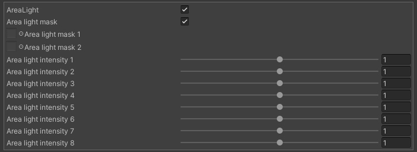

# Area Light
Takenoko Standard Shader は Area Light をサポートしています。基本的な使用方法については、[こちら](../arealight.mdx)を参照してください。

Standard Shader では、各 Area Light から受ける光の強さを Intensity パラメータで個別に調整できます。

また、各 Area Light の影響範囲を制御するための Mask Texture を設定できます。マスク情報は各チャンネルにパッキングされており、1枚目の mask の R、G、B、A チャンネルが、それぞれ 1～4 番目の area Light の影響度を表します。同様に 2 枚目の mask は 5～8 番目の area light の影響度を表しています。Mask のパッキングには [Texture packer](../tool/texture_packer.mdx) をご利用ください。

## Parameters

