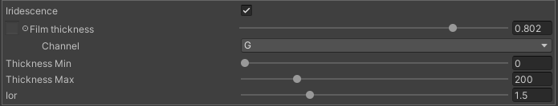

# Iridescence
Iridescence は薄膜干渉による色の変化を表現するマテリアルモデルです。

薄膜干渉とは表面に油や酸化被膜などの薄い層がある場合に、内部の散乱による光の干渉によって色が変化する現象です。例としては油膜の虹色、熱した金属の鮮やかな色などが挙げられます。

## Parameters


- Film thickness: 薄膜の厚さを表すパラメーターです。
    - 実際の厚さは [thickness_min ~ thickness_max] nmの範囲に変換されます。
- Thickness min: 薄膜の最小厚さ
- Thickness max: 薄膜の最大厚さ
- Ior: 薄膜の屈折率

## Implemetation

薄膜干渉のモデルとして [Belcour and Barla 2017] を使用しています。 [Belcour and Barla 2017] では薄膜干渉による色の変化をフレネルとして表現することで既存のモデルに組み込むことができるようになっています。

Takenoko shader では [Belcour and Barla 2017] によるフレネル値を使用して各マテリアルモデルに薄膜干渉を適用しています。

```
float3 IridescenceF = IridescenceFresnel(dotLH, thinFilmThickness, 1.0, thinFilmIor, bottomIor, bottomKappa);
```

正確な薄膜干渉の計算には最下層の複素屈折率が必要です。複素屈折率は複雑かつ非直感的であるため、インターフェイスとしては不適切です。従って、[Gulbrandsen 2014] を使用して、F0 から簡易的に複素屈折率を推定する方法を採用しています。

[Gulbrandsen 2014] では真正面から見た時の色(reflectivity)とグレージング角(edgetint)における色の二つから複素屈折率を推定します。当 shader では、F0とF90をそれぞれ reflectivity と edgetint に対応させることで、複素屈折率の計算をしています。

また、数値的な安定性のために、F0 と F90 の値を 0.0 ~ 0.95 の範囲にクランプしています。

```
ColorToComplexIor(clamp(F0, 0.0, 0.95), clamp(ShlickFresnel(F0, 0.01), 0.0, 0.95), bottomIor, bottomKappa);
```

薄膜干渉モデルでは様々な要因により thickness = 0 におけるフレネル値が一般的な Schlick 近似の結果と一致することは保証されていません。従って、thickness = [0, 50] の範囲で schlick 近似の結果と補間することで一致するように設計しています。

```
F = lerp(F, saturate(IridescenceF), smoothstep(0.0, 1.0, saturate(thinFilmThickness / 50.0)));
```


# References
- [Gulbrandsen 2014] Artist Friendly Metallic Fresnel
- [Belcour and Barla 2017] A Practical Extension to Microfacet Theory for the Modeling of Varying Iridescence
