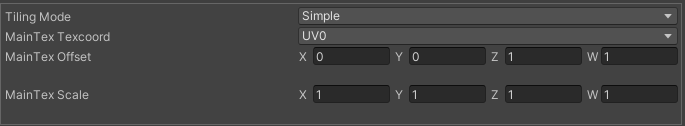
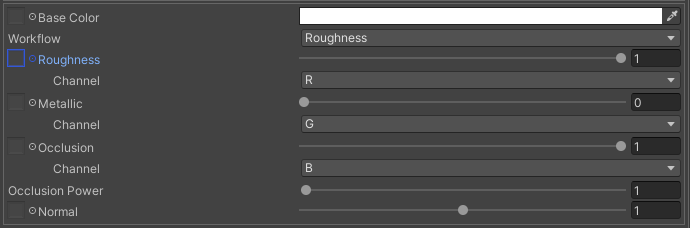

# Main Texture

マテリアルに使用する主要なパラメーターを設定する項目です。

Takenoko shader では metallic-roughness ワークフローを採用しており、basecolor, metallic, roughness, occlusion, normal が指定できます。また、smoothness texture も使用することができます。

各テクスチャは任意のパッキングに対応するため、読むチャンネルを指定することができます。

## Parameters

- Tilling Mode
- Texcoord: Main texture で使用する UV チャンネル
  - Offset: UV のオフセット
  - Scale: UV のスケール

- Basecolor: ベースとなるカラー
- Workflow: roughness または smoothness のどちらを使用するかを指定します。
- Roughness/Smoothness: 表面上の粗さ
  - Channel: 読むチャンネルを指定します。
- Metallic: 金属質の度合い
  - Channel: 読むチャンネルを指定します。
- Occlusion: アンビエントオクルージョンの度合い
  - Channel: 読むチャンネルを指定します。
- Normal: 法線マップ

