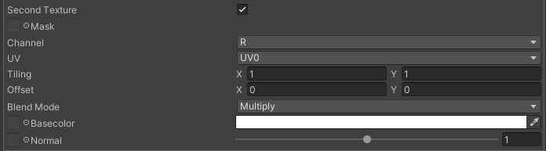

# Second Texture
Main texture に加えて、ディテールマップとして second texture を使用することができます。Second texture と main texture のブレンドはいくつか選択することができます。

## Parameters

- Mask: second texture の影響を受ける範囲を制御するマスクです。
    - Channel: マスクとして使用するテクスチャのチャンネルを指定します。
- UV: second texture の UV マッピングを指定します。
    - Offset: UV のオフセットを指定します。
    - Tiling: UV のタイル数を指定します。
- Blend mode: main texture と second texture のブレンド方法を指定します。
    - Replace: 線形補間で置き換えます
    - Add: 加算合成
    - Multiply: 乗算合成
    - Overlay: オーバーレイ合成
- Basecolor: second texture のベースカラーを指定します。
- Normal: second texture の法線マップを指定します。