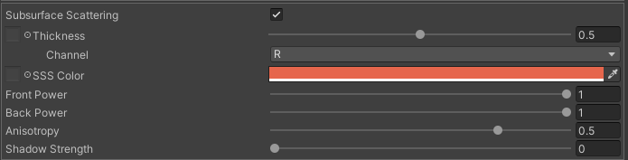

# Subsurface Scattering (SSS)

Subsurface scattering (SSS) は物体内部での光の散乱を表現するマテリアルモデルです。

SSS では前方のからの光の影響と後方からの光の影響で分けて計算しています。ここでは Front SSS、Back SSS と呼びます。

## Parameters


- Thickness: 物体の厚みを指定します。thickness が大きいほど SSS の影響が弱くなります。
  - Channel: Thickness map のチャンネルを指定します。
- SSS Color: 内部の色を指定します
- Front Power: 前面からの光の散乱の強さを指定します。
- Back Power: 背面からの光の散乱の強さを指定します。
- Anissotropy: 散乱の方向性を指定します。-1では後方、0で等方、1で前方への散乱が強くなります。
- Shadow Strength: 影の強さを指定します。

# Implementation

SSS の実装は Front SSS $f_{\text{SSS, front}}$ と Back SSS $f_{\text{SSS, back}}$に分けて行っており、それぞれの結果を加算する形で最終的な SSS を出力しています。

$$
f_{\text{SSS}} = f_{\text{SSS, front}} + f_{\text{SSS, back}}
$$

Front SSS $f_{\text{SSS, front}}$ は warp diffuse によって計算しています。

```
float3 w = saturate(sssColor);
float3 sssFront = frontPower * basecolor * max(dot(normalWS, lightWS) + w, 0.0) / ((1.0 + w) * (1.0 + w));
```

Back SSS $f_{\text{SSS, back}}$ は[Brisebois, Bouchard, 2011]の手法をベースにして位相関数をかけたものとして実装しています。
```
float cosTheta = clamp(dot(viewWS, -lightWS), -1.0, 1.0);
float phase = HgPhase(cosTheta, clamp(anisotropy, -0.95, 0.95));
float transmission = 1.0 - saturate(thickness);
float3 sssBack = backPower * sssColor * transmission * phase;
```

## References
- [Brisebois, Bouchard, 2011] Approximating Translucency for a Fast, Cheap and Convincing Subsurface Scattering Look