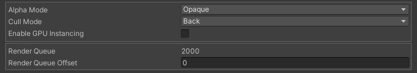

# Pipeline

Pipeline ではマテリアルの描画順序などのグラフィックスパイプラインに関する設定を行えます。

## Parameters

- Alpha Mode: 透明の扱いを指定します。
    - Opaque: アルファを無視して不透明として扱います。Z 値が記録されます。
    - Cutout: 特定の値以下のアルファを完全な透明として扱います。Z 値が記録されます。
    - Transparent: アルファを透過として扱います。Z 値は記録されません。
- Cull Mode: カリングの方法を指定します。
    - Off: カリングを行いません。
    - Front: 前面をカリングします。
    - Back: 背面をカリングします。
- Enable GPU Instancing: GPU Instancing を有効化します。
- Render Queue: レンダーキューの値です。
    - Render Queue Offset: レンダーキューをこの値を使ってオフセットします。